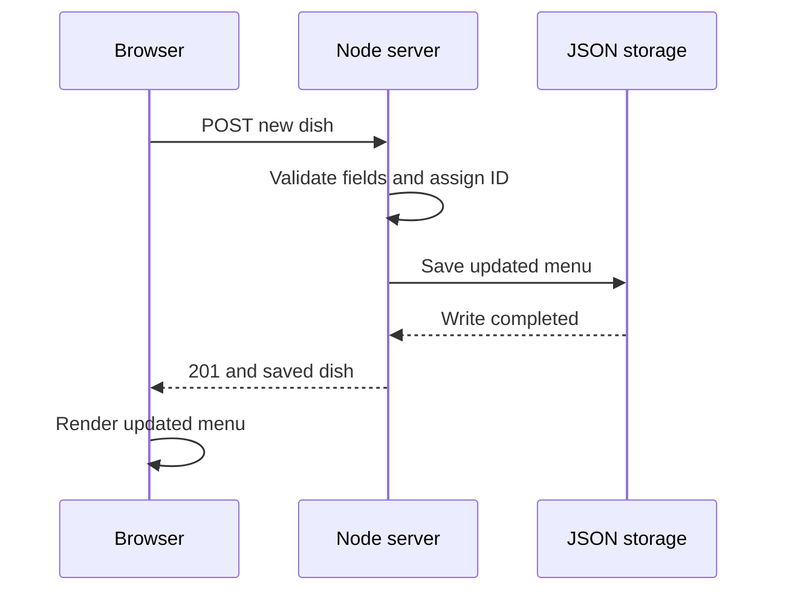

# Table & Thyme

## JavaScript food menu manager · Tertiary coursework project

Build and explain a full-stack application that adds, displays, edits and removes dishes. Every confirmed change appears immediately in the current menu. A local JSON file keeps changes across browser refreshes and server restarts. The starter menu contains three sample dishes priced in South African rand.

By the end of the project, you should be able to trace a form submission from a browser event to an HTTP request, validate and store the submitted data, and render the updated menu without reloading the page.

## 1. Installation and first run

1. Extract the entire ZIP into a folder on your computer.
2. Install [Node.js](https://nodejs.org/en/download) version 22 or later. The installer includes npm.
3. Open the extracted **table-and-thyme** folder in a terminal or in [Visual Studio Code](https://code.visualstudio.com/download) under **File → Open Folder**. In VS Code, use **Terminal → New Terminal**.
4. Run these commands from the folder containing `package.json`.

   ```sh
   node --version
   npm --version
   npm start
   ```

5. Open [http://127.0.0.1:3000](http://127.0.0.1:3000) in a browser. Keep the terminal open. Press **Ctrl+C** in the terminal to stop the app.

Node.js and a browser are sufficient. This project uses built-in Node modules and browser APIs, so you can skip `npm install`. Use `node server.js` to start directly or `npm run dev` to restart the server when its JavaScript source changes.

### Plug-ins and tools

| Tool | Installation | What it does |
| --- | --- | --- |
| Browser DevTools | Built into the browser | Open **Network → Fetch/XHR** to inspect requests, responses and status codes. |
| REST Client for VS Code | In **Extensions**, search for `humao.rest-client` and select **Install** | Start the app, open `requests.http`, and click **Send Request**. Send the named create request first so the later requests can reuse its returned ID. |
| Prettier for VS Code | Search for `esbenp.prettier-vscode` in **Extensions** and select **Install** | Use **Format Document** to format HTML, CSS, JavaScript or JSON. |

Both editor extensions are optional. REST Client sends real requests to your local menu and changes its stored data when you use POST, PUT or DELETE.

## 2. Project structure

| File | Responsibility |
| --- | --- |
| `public/index.html` | Labeled form, menu list, status message and reusable dish card template. |
| `public/styles.css` | Desktop and mobile layout, typography, spacing and control states. |
| `public/app.js` | Browser events, `fetch()`, form state and rendering. |
| `server.js` | Serves the web page and implements the menu API, validation and HTTP responses. |
| `store.js` | Loads the menu and saves changes to disk. |
| `data/seed.json` | Three example dishes used to initialise a fresh installation. |
| `data/dishes.json` | Working data generated at startup. This is the file the server updates. |
| `package.json` | Sets JavaScript module mode and defines start, dev and test commands. |
| `requests.http` | Sample requests for reading, creating, updating and deleting dishes. |
| `test/menu.test.js` | Automated HTTP tests using a temporary data folder. |

## 3. Connectivity and data flow

The browser loads HTML, CSS and JavaScript from the Node server on port 3000. Browser JavaScript sends relative requests such as `fetch('/api/dishes')` back to that same origin. The setup works locally without a separate API host, database service, API key or internet connection after Node is installed. The server listens on the computer running it. Use the same address for both the page and API when testing.



| Action | Method and URL | Success |
| --- | --- | --- |
| List dishes | `GET /api/dishes` | `200` with a JSON array |
| Read one dish | `GET /api/dishes/:id` | `200` with a dish object |
| Add a dish | `POST /api/dishes` | `201` with the created object and a `Location` header |
| Save changes | `PUT /api/dishes/:id` | `200` with the updated object |
| Remove a dish | `DELETE /api/dishes/:id` | `204` with an empty response body |

Replace `:id` with the dish ID returned by the API. PUT sends all four editable fields. Send `Content-Type: application/json` on POST and PUT. Invalid data returns `400`, a missing dish returns `404`, and server write errors return `500`. The UI reports failures and keeps the current menu visible when a write fails.

## 4. JavaScript breakdown

### The dish object

```json
{
  "name": "Vetkoek",
  "category": "Main",
  "priceCents": 4900,
  "description": "Served warm."
}
```

The browser sends these four fields. The server adds a unique `id` with `randomUUID()`. Edits keep that ID so the app can identify a dish even when its name changes. Duplicate dish names are allowed. Available categories are Starter, Main, Dessert and Drink.

The browser converts the decimal input using `Math.round(Number(formData.get('price')) * 100)`. The server validates cents as a whole number between 0 and 999999. The display divides cents by 100 and formats the amount with `Intl.NumberFormat` using ZAR.

### Browser JavaScript in public/app.js

| Function or state | What to study |
| --- | --- |
| `dishes`, `editingId`, `loaded`, `busy` | These values track the displayed list, the record being edited, and when controls can accept input. |
| `loadDishes()` | Reads the menu on startup. On failure it displays an error and offers a retry. |
| `requestMenu()` | Awaits `fetch()`, handles network errors, reads JSON, and checks `response.ok`. A successful DELETE has no JSON body. |
| `saveDish()` | Stops normal form navigation with `preventDefault()`, reads `FormData`, chooses POST or PUT and sends JSON. The returned dish updates the list after the server saves it. |
| `editDish()` and `resetEditor()` | Populate fields using the chosen record, switch form mode, and return the form to add mode after a successful save or cancellation. |
| `removeDish()` | Asks for confirmation, sends DELETE, and uses `filter()` to remove the confirmed record from the displayed list. |
| `renderDishes()` | Uses `map()` to clone one template per dish and `replaceChildren()` to replace the menu contents. It sets user-supplied strings with `textContent` so markup entered in a dish name displays as text. |
| `syncControls()` and `announce()` | Pause controls while a request is in progress and report the result through a visible live region. |

### Server JavaScript in server.js

1. `createMenuServer()` opens the data store and starts tracking requests. Main entry code calls `listen()` on the selected port.
2. The request handler compares the HTTP method and URL. A small asset map serves the web page and static files, and the API routes work with the stored collection.
3. `readDish()` checks the JSON header, limits the request body, parses it and validates the editable fields. The form has its own input checks, and the server also validates direct API calls.
4. POST prepends the new object. PUT builds a replacement array with `map()`. DELETE builds an array excluding the chosen ID with `filter()`. Each write waits for storage before sending success.

### Persistence in store.js

`openMenuStore()` copies the seed only if there is no working data file. It loads the file into an array. After each mutation, the store writes the new array to a temporary file, renames that file over the working file, then publishes the new in-memory state. A promise queue makes overlapping writes run in order within one server process. This classroom design uses a single local server. Browser tabs show updates from their own actions, and refreshing a tab pulls the latest saved list.

## 5. CSS breakdown

The HTML loads `public/styles.css` through `<link rel="stylesheet" href="/styles.css">`. Every dish created by JavaScript uses the same template classes, so newly added and edited dishes inherit the card styles automatically.

| CSS section | What to study |
| --- | --- |
| `:root` | Custom properties store the forest-green, cream and gold palette. Change a variable once to update each rule that uses it. |
| `.workspace` and `.dish-card` | CSS Grid controls the editor and menu columns, then the dish details and price columns inside each card. |
| `.form-actions` and `.dish-actions` | Flexbox lets controls sit side by side and wrap when space is tight. |
| `:focus-visible`, `:hover` and `:disabled` | Pseudo-classes style keyboard focus, pointer interactions and controls waiting for a server response. |
| `#message[data-error="true"]` | JavaScript sets the `data-error` attribute. CSS reads it to switch the status message from green to red. |
| `@media` | The layout stacks the editor and menu at 740 px. At 480 px, dish details and actions stack inside each card. |

## 6. Test and demonstrate

Run `npm test` from the project folder. It starts its own server on a free port and writes to a temporary directory. The test covers invalid input, concurrent additions, updating an existing dish, removing a dish and retaining changes after a restart.

| Step | What you should see |
| --- | --- |
| Start the app with a fresh folder. | Three sample dishes and their prices appear. |
| Add **Vetkoek** as a Main at **49.00**. | The new dish appears immediately, and the count increases by one. |
| Edit it to **Curried Vetkoek** at **52.00**. | The original card shows the new name and price, and the count stays the same. |
| Refresh the page, then restart the server. | The edited dish is still present after both checks. |
| Press **Remove**, cancel, then repeat and confirm. | Cancelling preserves the card. Confirming removes it and decreases the count. |
| Try a blank name or negative price. | The form or API rejects the input. |
| Open at a narrow browser width. | The form and list stack vertically. |

For a coursework demonstration, show the add–edit–remove sequence and open the Network panel to identify the method, status code and returned JSON for each action. Then explain why the dish ID stays stable and how the JSON file retains the final state. A useful extension exercise is a category filter implemented on the browser's current list.

### Troubleshooting

| Symptom | Resolution |
| --- | --- |
| `node` is unknown | Install Node.js and reopen the terminal so it picks up the executable. |
| `package.json` is missing | Change into the extracted `table-and-thyme` folder before running npm. |
| Port 3000 is in use | Stop the other service or start with `PORT=3001 npm start` on macOS/Linux, or `$env:PORT = '3001'; npm start` in PowerShell. Open the matching URL and update `@host` in `requests.http` if using it. |
| The page opens but cannot load the menu | Start the Node server and browse to its printed URL. Opening the HTML file directly or through a static editor server does not start the API. |
| You need a fresh demonstration menu | Stop the server and use a fresh extraction of the ZIP. The original working directory retains its saved dishes. |

## References

- [Node.js downloads](https://nodejs.org/en/download)
- [MDN Fetch API guide](https://developer.mozilla.org/en-US/docs/Web/API/Fetch_API/Using_Fetch)
- [VS Code REST Client extension](https://marketplace.visualstudio.com/items?itemName=humao.rest-client)
- [VS Code Prettier extension](https://marketplace.visualstudio.com/items?itemName=esbenp.prettier-vscode)
